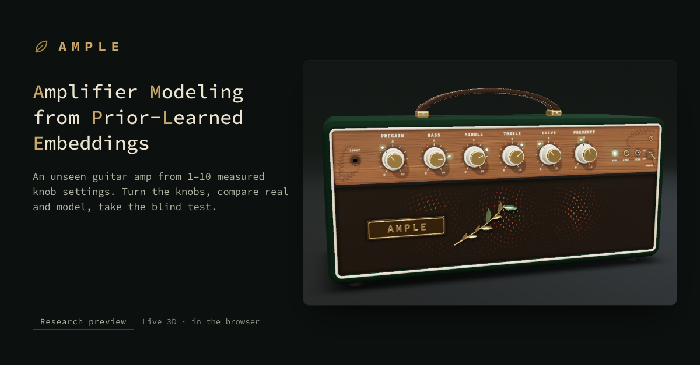

<p align="center">
  
</p>

<h1 align="center">AMPLE</h1>
<p align="center"><b>Amplifier Modeling from Prior-Learned Embeddings</b><br>
An unseen guitar amp from 1–10 measured knob settings.</p>

<p align="center">
  <a href="https://astycx.github.io/AMPLE-showcase/"><b>▶ Open the live demo</b></a>
</p>

> [!NOTE]
> Research preview, 2026. Results hold within one simulator family (Guitarix).

<p align="center">
  Project Goal: to learn a new amp from the fewest knob measurements possible by pre-training the model on multiple amp sims.
</p>

## What you can do
- Turn the knobs of a 3D amp, which snap only to the pre-measured test settings
- Switch between the real amp (Guitarix), the model and the dry DI
- Take a blind test: which one is the real amp?

## How it works
1. **Pretrain on 100 amps**: for each amplifier we pass the input DI through it at 200 knob settings (4-second excerpts of the DI each), and the network learns to turn the DI and the knob values into the amp's output.
The network is a WaveNet with embeddings and FiLM conditioning on the knob values and the embedding. The result of the learning process is a small network of about 21k weights. The training loss is the waveform error (MSE) plus a spectral (log-mel) error; ESR is used to evaluate the results.
2. **Measure an unseen amp**: an amp unseen during training is measured at a certain number of knob settings (N).
3. **Adjusting:** by adjusting the network according to one of the project methods (listed in the next chapter), we get the final simulation for the unseen amp (the main method is card fitting).

## Methods compared
All 4 get the same N measured knob settings of the new amp:
- **Card** (main project method): all the weights are frozen, and only the embedding card, which specifies the amp's characteristics and describes its sound, is learned
- **Fine-tune**: all weights are fit, starting from the pre-trained network (2000 steps)
- **Nearest known amp**: nothing is trained; the closest of the 100 learned amps is chosen
- **From scratch**: the same network is trained from scratch (on the same N settings, 30000 steps)

## Results
**Main result:** with N = 1 and 3, the card and fine-tuning have a 14–26× lower error than training from scratch; at N = 10 still 7–9×.

| Method | N = 1 | N = 3 | N = 10 |
|---|---:|---:|---:|
| **Card** | **0.0340** | **0.0261** | **0.0256** |
| … | | | |

<sub>Median ESR over 5 unseen amps × 50 test settings; lower is better.</sub>

<details><summary>What you hear on the page</summary>

…
</details>

## Limits
- …

## Run locally
```bash
python3 -m http.server 8000
